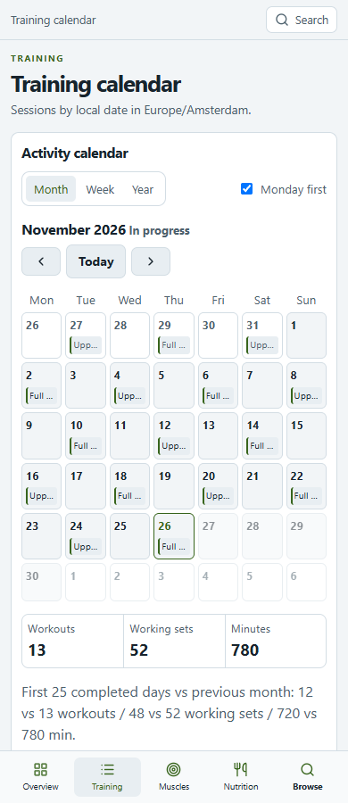
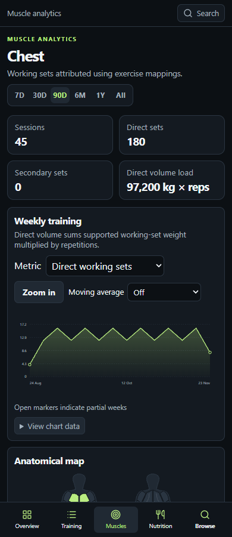
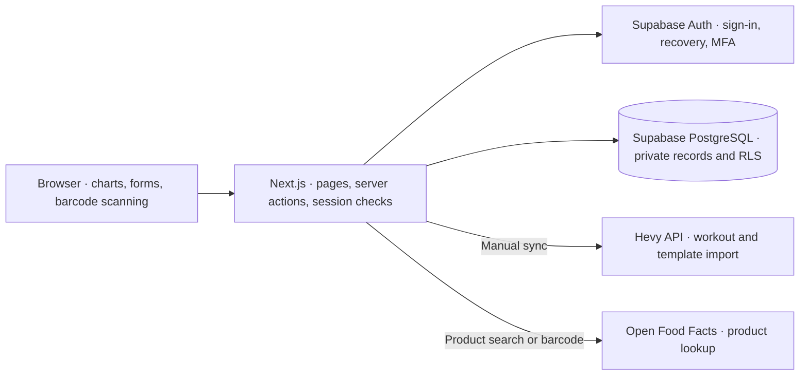

# PERSONALGYMTRACK

PERSONALGYMTRACK is a private workspace for understanding your training. Bring in workouts from Hevy, review how your strength and training volume change over time, and follow your nutrition and bodyweight alongside your workout history.

You can open the interface without an account in **setup mode**. Connect your own Supabase project to save records and use the private workspace.

[Features](#features) · [Run locally](#run-locally) · [Connect your data](#connect-your-data) · [Testing](#testing) · [Deployment](#deployment)


<details>
<summary>Mobile screenshots</summary>

<p>
  
  
</p>

</details>

*Screenshots show the running app with synthetic workout data.*

## Features

| Area | What you can do |
| --- | --- |
| **Dashboard** | Review training volume, working sets, frequency, bodyweight, today's logged calories, and recent personal records. Switch metrics, zoom charts, and open the underlying data tables. |
| **Calendar and workouts** | Browse month, week, and year views, see training totals on an activity heatmap, search your workout history, and open sessions to review sets, reps, weight, and RPE. |
| **Exercise and muscle analytics** | Track estimated one-rep max, recorded load, and rep-specific records. Select a region on the front or back muscle map to see direct and secondary sets and exercise progression. |
| **Nutrition** | Log food by meal and portion, reuse favorites and recipes, set calorie and macro targets, and compare completed diary days with bodyweight or estimated strength trends. |
| **Body measurements and goals** | Record bodyweight and other measurements, review weight trends, set workout-frequency or weight goals, and explore a recap of a selected training period. |
| **Workspace** | Use light, dark, or OLED themes, navigate with the keyboard and search, manage account security, and download a JSON export of training, measurements, goals, and workspace settings. |

## Run locally

You need **Node.js 22.x**, npm, and Git access to this private repository. Open the repository's **Code** menu and copy its clone URL.

```sh
git clone --branch feature/premium-fitness-intelligence "YOUR_REPOSITORY_CLONE_URL" PERSONALGYMTRACK
cd PERSONALGYMTRACK
npm ci
npm run dev
```

Open [localhost:3000](http://localhost:3000). Setup mode lets you explore the dashboard, calendar, and navigation with empty charts. For a local production build, run `npm run build` followed by `npm start` after stopping the development server.

## Connect your data

### Environment variables

Copy [`.env.example`](.env.example) to `.env.local` from the repository root. Use `cp .env.example .env.local` on macOS or Linux, or `Copy-Item .env.example .env.local` in PowerShell. Skip the copy if you already have a local configuration.

| Variable | Example placeholder | When needed |
| --- | --- | --- |
| `NEXT_PUBLIC_SUPABASE_URL` | `https://YOUR_PROJECT_REF.supabase.co` | Signing in and saving records |
| `NEXT_PUBLIC_SUPABASE_PUBLISHABLE_KEY` | `YOUR_SUPABASE_PUBLISHABLE_KEY` | Signing in and saving records |
| `HEVY_API_KEY` | `YOUR_HEVY_API_KEY` | Optional Hevy API sync |
| `HEVY_OWNER_ID` | `YOUR_SUPABASE_USER_UUID` | Required with the Hevy key. Use the invited user's **User UID** from Supabase Auth. |
| `OPEN_FOOD_FACTS_CONTACT` | `operator@example.com` | Optional operator contact included in food lookup requests |

Get the Supabase URL and **publishable** key from your project's Connect dialog. The app uses that key and the signed-in user's session. Keep real values in the ignored `.env.local` file and restart the server after updating it.

### Set up Supabase

1. Create a development Supabase project and install the [Supabase CLI](https://supabase.com/docs/guides/local-development/cli/getting-started). In a fresh checkout, run `supabase init` once from the repository root to create the CLI configuration. Then link the development project and inspect the migration plan.

   ```sh
   supabase login
   supabase link --project-ref YOUR_PROJECT_REF
   supabase migration list --remote
   supabase db push --dry-run --remote
   ```

   Once you confirm the target and pending files, run `supabase db push --remote`. The four [migrations](supabase/migrations) run in filename order. They create the training and body measurement schema, add MFA enforcement, manage sync state, and add the nutrition diary. On an existing project, compare its migration history and schema before applying pending changes. See the [Supabase migration workflow](https://supabase.com/docs/guides/local-development/cli-workflows).

2. In Supabase Auth, disable public signup for an invite-only workspace. Set the Auth Site URL to the app origin you intend to open from email, such as `http://localhost:3000` for local testing. Configure allowed redirect URLs and email delivery for that environment.
3. In the Supabase [email templates](https://supabase.com/docs/guides/auth/auth-email-templates), point the **Invite** and **Reset Password** links to the app's confirmation route.

   ```text
   {{ .SiteURL }}/auth/confirm?token_hash={{ .TokenHash }}&type=invite
   {{ .SiteURL }}/auth/confirm?token_hash={{ .TokenHash }}&type=recovery
   ```

4. Invite yourself from **Authentication → Users**. Open the invitation in your browser, then set a password in **Settings** and optionally enroll an authenticator app. The workspace requires the authenticator code after enrollment. Open [localhost:3000/app](http://localhost:3000/app) after setup.

### Import your workouts

**Hevy API.** Create a key in [Hevy Developer Settings](https://hevy.com/settings?developer), configure `HEVY_API_KEY` and `HEVY_OWNER_ID`, then restart the server. Sign in as that user and open **Settings → Integrations → Test connection → Sync workouts**. Sync runs on demand. It imports workouts and exercise templates, then reconciles later edits and deletions. [Hevy developer documentation](https://developers.hevy.com/)

**CSV.** You can also upload a Hevy export under 1.5 MB from **Integrations**. Choose one source for the same workout history to avoid duplicates. CSV exercises lack the template metadata needed for mapped muscles, loaded volume, and estimated one-rep max.

### Log food

Open **Nutrition → Log food**. Search [Open Food Facts](https://openfoodfacts.org/) by product name, brand, or barcode, or enter a custom food from its label. Choose the portion and meal, then add it to the diary. Open Food Facts lookup uses the public API without an API key. The camera scanner requires a supported browser, permission, and a secure context such as HTTPS or localhost. Barcode entry also works by keyboard.

## Technology and architecture

| Layer | Stack |
| --- | --- |
| App | Next.js 16.4.6 App Router, React 19, TypeScript 5.9, Node.js 22 target |
| Interface | CSS, native SVG charts and muscle maps, Lucide icons |
| Data and identity | Supabase Auth, Supabase SSR, PostgreSQL with row-level security |
| Import and validation | Hevy API, Papa Parse, Open Food Facts, ZXing barcode scanning, Zod |
| Verification | ESLint, Vitest, PGlite, Playwright |



**Authentication and privacy.** Server routes and mutations check the Supabase session. PostgreSQL policies scope records to their owner and require a verified MFA session after enrollment. The app uses HTTP-only session cookies, Secure cookies in production, a nonce-based Content Security Policy, and private, non-cacheable responses. [Security controls](SECURITY.md) · [Security audit and verification gaps](docs/security-audit.md)

**Performance.** Routes fetch the data they use. The diary reads nutrition and training data in parallel. Workout lists render compact summaries and open full sets in the replay view. The browser loads the barcode decoder when scanning starts. Hevy sync runs only when requested. [Architecture notes](docs/architecture.md) · [How metrics are calculated](docs/data-model.md)

## Testing

```sh
npm run lint
npm run typecheck
npm test
npm run build
npx playwright install chromium
npm run test:e2e
```

Playwright runs the setup experience in desktop and mobile Chromium. Stop any development server running from this checkout first so Playwright can start its own instance. Set `PGT_BROWSER_PATH` to use an existing Chromium-based browser, or set `PGT_E2E_PRODUCTION=1` after building to test the production server. Screenshots and reports are ignored by Git.

The latest application verification passed lint, type checking, the production build, **24 unit and integration tests**, and **12 Playwright tests**. The database tests use embedded PostgreSQL with two synthetic owners. A separate loopback fixture covered authenticated pages and nutrition logging, and browser screenshots covered both themes at four viewport widths. Hosted provider and deployment checks are listed in the [security audit](docs/security-audit.md).

## Deployment

The repository includes a [Vercel configuration](vercel.json) for Next.js functions in Frankfurt. For a restricted preview:

1. Import the private repository into Vercel, choose the Next.js preset and Node.js 22.x, and enable Deployment Protection before sharing the URL.
2. Use a separate Supabase project for preview. Apply its migrations and set the environment variables for the **Preview** environment in Vercel.
3. Set the preview project's Supabase Auth Site URL and allowlist to the approved HTTPS origin. Verify invitations and recovery, MFA, isolation between two test accounts, and import and sync behavior before using real records.

[Vercel Git deployment](https://vercel.com/docs/git) · [Environment variables](https://vercel.com/docs/environment-variables) · [Deployment protection settings](https://vercel.com/docs/project-configuration/security-settings)

## Known limitations

- A deployment supports one Hevy API owner. Large initial imports can hit the sync timeout. The application supports manual sync and CSV import.
- Workout dates use Europe/Amsterdam. CSV timestamps in daylight-saving gaps or overlaps need an explicit UTC offset.
- Open Food Facts labels may be incomplete. Unknown nutrient values remain unknown, and intake averages use diary days marked complete with known calories.
- The JSON export covers training and workspace records. Nutrition is stored separately and is outside the current export.
- Hosted authentication lifecycle checks, direct Supabase API isolation checks, live sync, and physical camera testing remain release verification tasks.

## Roadmap

These are proposed improvements for future work.

1. Complete the private release checks for hosted authentication, isolation, and import performance.
2. Add side-by-side workout and period comparisons.
3. Make long Hevy imports resumable and evaluate per-user OAuth.
4. Extend data export to nutrition and add self-service account deletion.

[Design notes](docs/design-system.md)
