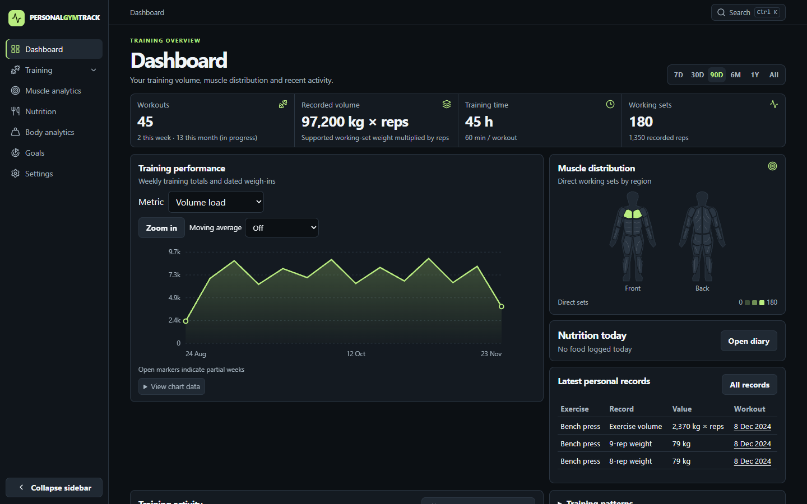

# PERSONALGYMTRACK

**Hevy tracks your workouts. PERSONALGYMTRACK helps you understand your progress.**

Bring your workouts, nutrition, bodyweight, and goals together in one private, self-hosted workspace.



## What you can do

- **See what’s changing.** Daily Intelligence highlights trends in strength, training volume, and consistency. Use Performance Replay to compare training periods.
- **Connect your training.** Sync with Hevy Pro or import a Hevy CSV from **Settings → Integrations**.
- **Track nutrition and bodyweight.** Log meals with Open Food Facts, follow your calorie and macro targets, and review suggested adjustments as you build up a history.
- **Get optional coaching.** Ask Coach about trends in your training, nutrition, and recorded training partners.

## Get started

**Already have a workspace?** Sign in with your invitation, then open **Settings → Integrations** to bring in your workouts. On a phone, open your workspace in Safari or Chrome and add it to your home screen. [Mobile installation guide](docs/self-hosting.md#install-on-mobile)

**Hosting your own workspace?** You’ll need Docker, Node.js 22, and a Supabase project. Follow the setup guide to prepare Supabase, run `npm run setup`, and start the app with `docker compose up -d`. [Self-hosting guide](docs/self-hosting.md)

**Want a quick look?** Run the app locally and open [localhost:3000](http://localhost:3000). You can explore the dashboard without connecting an account.

<details>
<summary>Run locally</summary>

With Git and Node.js 22 installed, run these commands in your terminal.

```sh
git clone https://github.com/Job-SJ/PERSONALGYMTRACK.git
cd PERSONALGYMTRACK
npm ci
npm run dev
```

</details>

## More help

To enable Coach, connect an [OpenRouter key](https://openrouter.ai/settings/keys), choose a recommended model, and confirm privacy consent and any paid spending limit.

[Coach setup and privacy](docs/ai-coach.md) · [Troubleshooting](docs/self-hosting.md#troubleshooting) · [Expo development](docs/mobile.md) · [Contributing and testing](CONTRIBUTING.md) · [Security](SECURITY.md)

Screenshots use synthetic data. © 2026 Job Sjobbema. [MIT License](LICENSE) · [Third-party notices](THIRD_PARTY_NOTICES.md)
